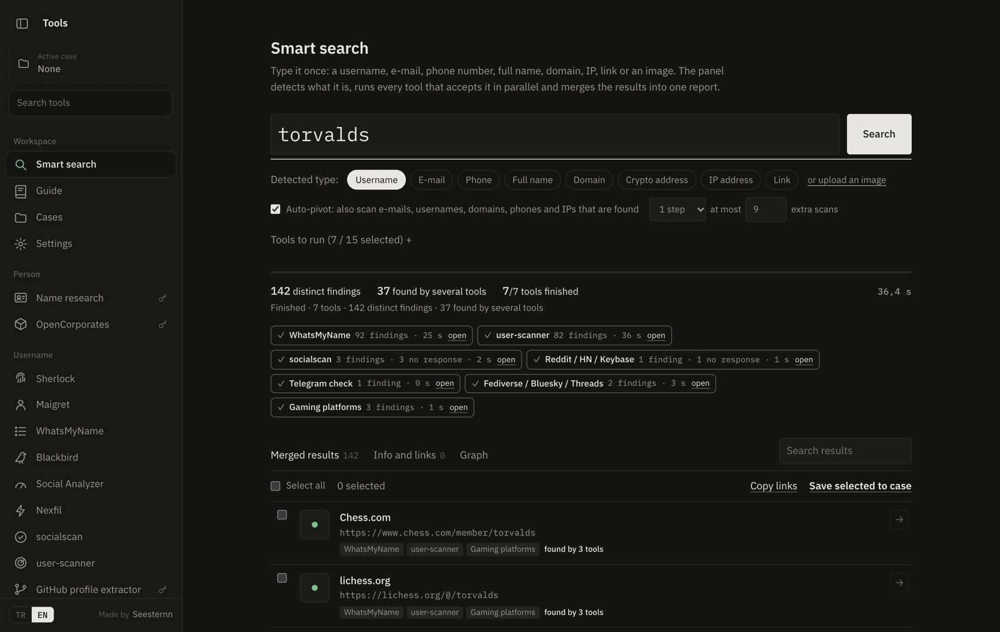
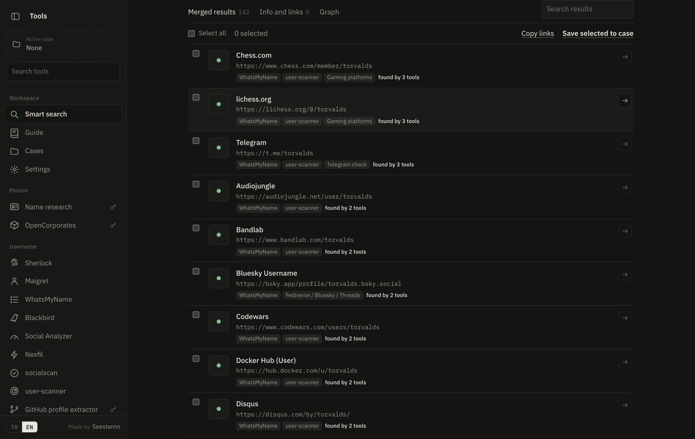
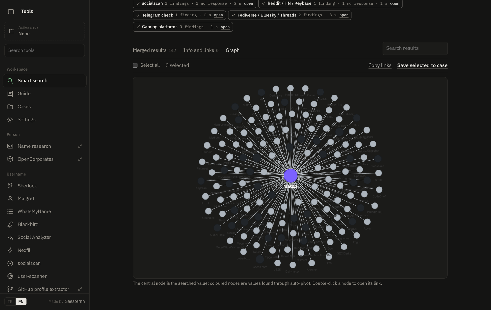
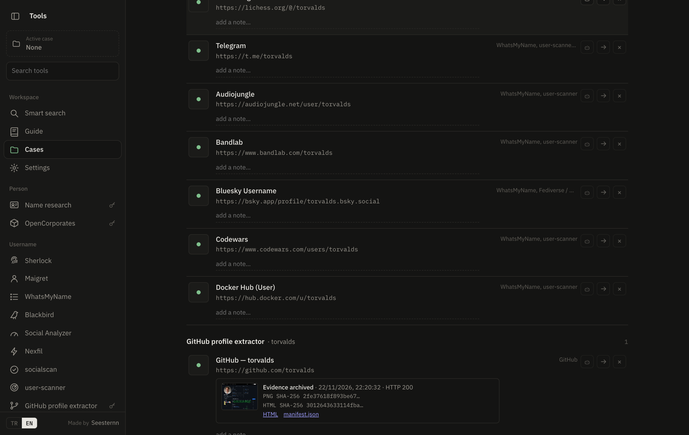
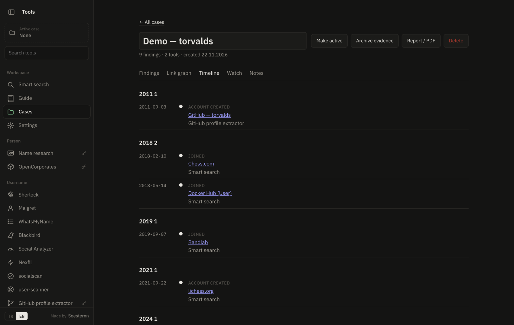

# OSINT Panel

**One search box for ~50 open-source intelligence tools.** Type a username, e-mail, phone number, full
name, domain, IP, link or crypto address — or drop an image. The panel detects what it is, runs every
tool that accepts it in parallel, follows the leads it finds, and merges everything into one report
you can select from, archive as evidence and keep watching.

Runs entirely on your own computer. Turkish and English interface.

[](https://github.com/Seesternn/osint-panel/actions/workflows/ci.yml)


> 🇹🇷 Türkçe açıklama aşağıda: [Türkçe](#türkçe)



## Why another OSINT tool?

Most OSINT tools do one thing and print a list. OSINT Panel is the workbench around them:

| | |
|---|---|
| **One input, all tools** | Type detection, every matching tool in parallel, results de-duplicated across tools with a "found by N tools" confidence signal. |
| **Auto-pivot + live graph** | E-mails, usernames, domains, phones and IPs found in results are scanned automatically (1–2 steps, with a budget). |
| **Evidence archive** | Full-page screenshot + raw HTML + SHA-256 manifest and UTC timestamp for every finding — profiles can vanish, your evidence doesn't. |
| **Watchlist** | Cases are re-checked on a schedule: accounts that disappear, changed profile photos or bios, confirmed new accounts. |
| **Possible persons** | Name research separates people with the same name using shared usernames, e-mails, identical photos and official links. |
| **Timeline** | Every date found in a case (account creations, uploads, breaches, archive captures…) on one axis. |
| **Plugins** | A new source is one Python file. Six bundled plugins show how. |
| **Headless** | `./osint` command line and a REST API for scripts and automation. |
| **Private by default** | Local only, keys stored locally, optional local AI (Ollama) so nothing leaves your machine. |

<table>
<tr><td></td>
<td></td></tr>
<tr><td></td>
<td></td></tr>
</table>

## Tools

| Input | Tools |
|---|---|
| Username | Sherlock, Maigret, WhatsMyName, Blackbird, user-scanner, socialscan, Nexfil, Social Analyzer, GitHub profile extractor, Reddit / HN / Keybase, Telegram, **Fediverse / Bluesky / Threads**, **Steam / Chess.com / Lichess**, username generator |
| E-mail | Holehe, e-mail account check (Gravatar, Microsoft, PGP), verifier, HIBP, h8mail, GHunt, header analyzer |
| Phone | PhoneInfoga, number parser, Ignorant, number-format search |
| Full name | Name research (Wikidata, news, academic records, GitHub, Bluesky, Stack Overflow, sanctions, real web search via local SearXNG, possible persons, deep scan, AI summary), **OpenCorporates** |
| Image / video | ExifTool, location finder (EXIF + GeoCLIP + OCR + optional AI), reverse image search, photo matching, ELA, video analysis |
| Domain / IP | WHOIS / DNS, crt.sh, subfinder + httpx, dnstwist, Wayback Machine, **archive.today + Common Crawl**, tracker-ID analysis, **favicon hash pivot**, Shodan, IP lookup, theHarvester, document metadata, SpiderFoot, Recon-ng |
| Crypto | **Bitcoin / Ethereum address** (balance, activity, ENS, public tags) |

**Bold** = plugin in [`panel/plugins/`](panel/plugins). Every tool keeps its own license and is downloaded at install time, not redistributed here.

## Quick start

### Docker (recommended)

```bash
git clone https://github.com/Seesternn/osint-panel.git && cd osint-panel
docker compose up -d --build      # first build takes a while
open http://127.0.0.1:5050        # Linux: xdg-open
```

- Data (settings, API keys, cases, evidence, your plugins) lives in the `osint-data` volume.
- The port is published on `127.0.0.1` only. To reach it from your network, change the port mapping in
  [`docker-compose.yml`](docker-compose.yml) **and** set `PANEL_TOKEN` (see [`.env.example`](.env.example)).
- Photo geolocation model: `WITH_GEOCLIP=1 docker compose build` (~1 GB more).
- GHunt needs a one-time login: `docker compose exec osint-panel tools/ghunt/bin/ghunt login`.
- Command line inside the container: `docker compose run --rm osint-panel osint search torvalds`.

### Local install (macOS / Linux)

Requirements: `git`, `curl`, [`uv`](https://docs.astral.sh/uv/). Optional: `exiftool`, `ffmpeg`, `phoneinfoga`,
`subfinder`, `httpx`, Chrome / Chromium (evidence screenshots), Tesseract (OCR on Linux).

```bash
./setup.sh              # everything (~3 GB with GeoCLIP)
./setup.sh --minimal    # panel + Sherlock + core Python tools
./setup.sh --no-geoclip
./run_panel.sh          # → http://127.0.0.1:5050   (launch_panel.sh also opens the browser)
```

API keys are optional and added on the **Settings** page; each field has a "Get key" link.

## Command line

```bash
./osint search torvalds                          # detect type, run default tools, merged table
./osint search someone@example.com --json        # machine-readable
./osint search example.com --tools whois,crtsh,favicon --csv --out domain.csv
./osint search "Ada Lovelace" --all --save-case "Ada"
./osint run github username=torvalds             # one tool, explicit inputs
./osint tools --type email                       # which tools accept e-mails
./osint watch 3                                  # re-check case 3 now
./osint archive 3                                # archive every link of case 3 as evidence
```

## REST API

```bash
# run Smart search server-side and wait up to 60 s for the merged result
curl -s -X POST http://127.0.0.1:5050/api/v1/search \
  -H 'Content-Type: application/json' \
  -d '{"value": "torvalds", "lang": "en", "wait": 60}'

# or start it and poll
curl -s -X POST http://127.0.0.1:5050/api/v1/search -H 'Content-Type: application/json' -d '{"value": "example.com"}'
curl -s http://127.0.0.1:5050/api/v1/search/<id>
curl -s http://127.0.0.1:5050/api/v1/tools
```

With `PANEL_TOKEN` set, send it as the `X-Panel-Token` header.

## Plugins

Drop a `.py` file into `panel/plugins/` or your user plugin folder (`$OSINT_PLUGIN_DIR`, default
`<data dir>/plugins_user`) and restart. Start from [`docs/plugin-template.py`](docs/plugin-template.py);
the API is documented in [`panel/plugin_api.py`](panel/plugin_api.py). A plugin can join Smart search
(`accepts`), add a Settings field for its API key, and ship English texts. Broken plugins are skipped and
listed at `/api/catalog`.

## Configuration

| Variable | Default | |
|---|---|---|
| `OSINT_DATA_DIR` | `panel/` (Docker: `/data`) | settings, cases, evidence, user plugins |
| `PANEL_HOST` / `PORT` | `127.0.0.1` / `5050` | listen address |
| `PANEL_TOKEN` | – | access key required for every request when set |
| `PANEL_ALLOWED_HOSTS` | – | extra host names allowed without a token (comma-separated); localhost is always allowed |
| `OSINT_PLUGIN_DIR` | `<data dir>/plugins_user` | user plugin folder |
| `CHROME_PATH` | auto-detected | browser used for evidence screenshots |
| `TESSERACT_LANGS` | `eng+tur` | OCR languages on Linux |

**Local AI:** install [Ollama](https://ollama.com), pull a model (e.g. `qwen2.5vl:7b` for photos and text) and
enter its address and name on the Settings page. Summaries and photo interpretation then run on your
machine instead of Gemini.

## Responsible use

OSINT Panel only queries public sources. It deliberately does **not** include leaked databases,
identity / address lookup panels or face recognition, and it never logs into accounts that aren't yours.
Use it for your own footprint, authorised investigations, journalism and research, respect each source's
terms, and follow the law where you live (e.g. GDPR / KVKK). Findings are leads, not proof — verify them.

## Disclaimer

This software is provided for lawful research, journalism, security work and personal-footprint checks.
You are solely responsible for how you use it and for complying with the laws that apply to you and with
the terms of the services you query. The author accepts no liability for misuse. Results can be wrong or
belong to someone else with the same name or username — never act on them without independent verification.
See also the [MIT license](LICENSE) (no warranty).

## Contributing

See [CONTRIBUTING.md](CONTRIBUTING.md). Security issues: [SECURITY.md](SECURITY.md). Changes: [CHANGELOG.md](CHANGELOG.md).

## Credits

- **Author:** Seesternn
- Built on the open-source projects it brings together: Sherlock, Maigret, WhatsMyName, Blackbird,
  user-scanner, socialscan, Holehe, h8mail, GHunt, PhoneInfoga, Ignorant, Instaloader, Toutatis,
  theHarvester, Nexfil, SpiderFoot, Recon-ng, dnstwist, subfinder, httpx, SearXNG, GeoCLIP, ExifTool and others.

## License

MIT © Seesternn — see [LICENSE](LICENSE).

---

## Türkçe

Bilgisayarında çalışan, ~50 açık kaynak istihbarat (OSINT) aracını **tek arama kutusunda** toplayan panel.
Kullanıcı adı, e-posta, telefon, ad soyad, alan adı, IP, bağlantı ya da kripto adresi yaz veya görsel yükle:
panel türünü anlar, o veriyi kabul eden bütün araçları aynı anda çalıştırır, bulduğu ipuçlarını da otomatik
tarar (pivot) ve sonuçları tek raporda birleştirir.

**Öne çıkanlar:** kanıt arşivi (ekran görüntüsü + HTML + SHA-256 özeti), izleme listesi (silinen hesap,
değişen fotoğraf / biyografi, yeni hesap bildirimi), olası kişi ayırma, zaman çizelgesi, eklenti sistemi,
komut satırı (`./osint`) ve REST API, isteğe bağlı yerel yapay zekâ (Ollama).

**Kurulum:**

```bash
docker compose up -d --build
```

Ya da Docker'sız: `./setup.sh` → `./run_panel.sh`. Adres: http://127.0.0.1:5050. Arayüz dili sol alttaki
TR / EN düğmesiyle değişir. API anahtarları **Ayarlar** sayfasından girilir ve yalnızca bu bilgisayarda saklanır.

**Sorumluluk reddi:** Yazılım yalnızca yasal araştırma, gazetecilik, güvenlik çalışmaları ve kişinin kendi dijital
izini incelemesi içindir. Kullanımdan ve ilgili yasalara / hizmet koşullarına uyulmasından kullanıcı sorumludur;
yazar kötüye kullanımdan sorumlu tutulamaz.

**Sorumlu kullanım:** Sızdırılmış veriler, kimlik / adres sorgu panelleri ve yüz tanıma bilinçli olarak yoktur.
Yalnızca kamuya açık kaynaklar kullanılır; KVKK ve ilgili mevzuata uyun. Bulgular ipucudur, kanıt değil —
mutlaka doğrulayın.

**Emeği geçenler:** Seesternn
